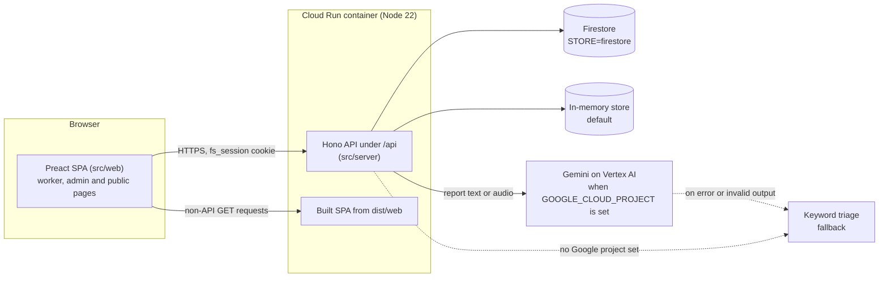

# FairShift

Fair, safe and transparent work for daily-wage and campus staff (UN SDG 8, Decent Work).

**Live demo:** <CLOUD_RUN_URL>

FairShift is one web app for two kinds of employers. Workers check in, see exactly how their pay was calculated, report safety problems anonymously in their own language, and keep a verifiable record of their skills. Employers see attendance, fatigue and overdue safety cases in one dashboard.

Two industries ship in the box: **construction** (daily wages at a site gate) and **college** (monthly salaries for campus support staff). A new sector is one configuration object.

## The problem

- **Opaque pay.** Workers cannot check how a daily wage, overtime, a night allowance, a provident fund deduction or an advance was calculated.
- **Fear of reporting.** Unsafe conditions and harassment go unreported because workers fear retaliation, and hazards surface only after an incident.
- **Lost career history.** Training and experience live on paper or in memory, so workers cannot prove their skills to the next employer.
- **Employer blind spots.** Overwork, lack of rest days and absence patterns are invisible until someone quits or gets hurt.

## What FairShift does

| Feature | For workers | For employers |
|---|---|---|
| **Check-in with automatic overtime** | Scan the site QR at the gate, or check in by location if within the site radius. Overtime and night hours are calculated on check-out. | A kiosk page shows a rotating site QR (new code every 60 s, page refreshes every 30 s). Shift hours feed payroll and fatigue rules. |
| **Transparent payslip** | Each line shows its arithmetic, for example "16 days × ₹750". Read-aloud is available. | The same line items are produced from the same rules for every worker. |
| **Anonymous safety reports** | Describe a problem by text or a voice note (up to 60 s), in English, Hindi or Tamil. Get a case code and track status without an account. | Reports come with a category, a severity and a service-level deadline. Overdue cases are flagged. Status changes and notes are visible to the reporter. |
| **Fatigue alerts** | See your own alerts for long shifts, short rests, long runs without a rest day and heavy weeks. | A fleet-wide fatigue list with the same rules. |
| **Explainable quit-risk** | Not shown to workers. | A 0 to 100 score with its factors listed (see below). Never uses anonymous reports or feedback. |
| **Skill passport** | See training, certification and experience entries, and share a signed link. | Add entries for each worker. Anyone can verify a passport with the platform's public key. |
| **Anonymous feedback** | One response per month rating safety, fairness, respect and workload (1 to 5), with an optional comment. | Averages and comments appear only once a site has at least 5 responses. |

**Fatigue rules** (look-back of 14 days of completed shifts):

- `long_shift`: any shift longer than 12 hours (high).
- `short_rest`: less than 10 hours between two shifts (medium).
- `no_rest_day`: 7 or more consecutive days with a shift (high).
- `weekly_overload`: more than 60 hours in a rolling 7-day window (medium).

**Quit-risk factors** (points added to a 0 to 100 score; low below 30, medium below 60, high from 60):

- `high_overtime`: more than 20 overtime hours in 14 days (+25).
- `fatigue`: +10 per fatigue flag, capped at 30.
- `absences`: +8 per scheduled Monday-to-Saturday day not worked, capped at 24.
- `new_joiner`: tenure under 90 days (+15).
- `declining_attendance`: at least 2 fewer days worked in the last 7 days than the 7 before (+10).

### How a payslip is computed

Money is stored in paise (₹1 = 100 paise). A worked day counts 1 if it has at least 4 hours, and 0.5 if it has fewer.

Example, construction, 16 days at ₹750:

| Line | Calculation | Amount |
|---|---|---|
| Base | 16 days × ₹750 | ₹12,000.00 |
| Provident fund (deduction) | 12% of base, capped at ₹1,800 | ₹1,440.00 |
| ESI (deduction) | 0.75% of gross, because gross is at most ₹21,000 | ₹90.00 |
| **Net** | 12,000 − 1,440 − 90 | **₹10,470.00** |

Other rules:

- Overtime is paid at 2× the hourly rate. Daily-wage hourly rate is ₹750 / 8 hours.
- Night hours (22:00 to 06:00 IST) earn an allowance per hour.
- Monthly pay (college) is the salary minus each absent working day at salary / 26.
- Advances for the period are shown as their own deduction line.

## Two industries, one platform

### Construction: Skyline Towers (daily wages)

Workers are paid per day. A Tamil-speaking electrician and a Hindi-speaking helper scan the site QR at the gate each morning. The site supervisor sees who is on site on the dashboard. A 13-hour shift raises a fatigue flag for the supervisor to act on.

A worker reports a near-fall on the fourth floor from the phone. The report is stored without a worker ID, PII is masked, and the case code lets the worker see when the supervisor acknowledged it. The keyword rules rate it critical because of the word "fell", so it is due within a day. With Gemini configured, the model chooses the category and severity instead.

### College: Greenfield College Campus (monthly salaries)

Support staff, such as lab assistants and security guards, are paid a monthly salary for 26 working days. Each absence reduces the base by one day rate. A lab assistant sees their payslip with the absence deduction shown. A spark from a socket in a lab is reported as electrical, which the keyword rules rate high. The facilities manager sees it in the reports queue with its deadline.

### Configuration comparison

From `src/shared/industries.ts`:

| Setting | construction | college |
|---|---|---|
| Pay model | `daily` | `monthly` |
| Base pay | `dailyWage` ₹750 per day | `monthlySalary` ₹18,000 for `workingDaysPerMonth` 26 |
| Regular hours per day | 8 | 8 |
| Overtime multiplier | 2 | 2 |
| Night allowance (22:00 to 06:00 IST) | ₹25 per hour | ₹20 per hour |
| Half-day threshold | 4 hours | 4 hours |
| Hazard categories | 9 (fall_height, scaffolding, electrical, heavy_machinery, ppe_missing, heat_stress, harassment, wage_issue, other) | 8 (electrical, chemical_lab, slippery_floor, fire_safety, workload, harassment, wage_issue, other) |
| Check-in modes | `qr`, `geo` | `qr`, `geo` |

### Adding a hospital or factory

A new sector is added as one entry in `INDUSTRIES` in `src/shared/industries.ts`, typed `Record<Industry, IndustryConfig>`, so the compiler requires it. The `Industry` union in `src/shared/types.ts` gets the new id. Its hazard categories also need `hazard.<id>` labels in `src/web/i18n/en.json`, `hi.json` and `ta.json`. Payroll, attendance, fatigue, quit-risk and reporting code is shared and does not change.

## Privacy and anonymity by design

- **Reports store no identity.** A stored report has no worker ID, no IP address and no time of day, only the IST calendar day. The report route ignores any session cookie. A test checks this even when a session is present.
- **Audio is not stored.** A voice report is sent to Gemini for transcription within that request. The stored record holds text only.
- **PII is masked before storage.** Emails, 12-digit Aadhaar-style numbers (4-4-4), and 10-digit Indian mobile numbers (with optional +91) are replaced with `[redacted]` in both the original and the English text. This is pattern-based, so it is a safeguard, not a guarantee. The Gemini prompt also asks the model to remove names.
- **Case codes** are 8 random characters from an alphabet without 0, 1, I, L or O, shown as `XXXX-XXXX`.
- **Feedback has no user ID.** The one-per-month check stores an HMAC of user, site and month in a separate set, never next to the response. Comments are redacted and shuffled.
- **Small groups stay hidden.** Feedback aggregates are returned only at 5 or more responses. Below that, the API returns only a count.
- **Quit-risk never reads reports or feedback.**
- **Logs are minimal.** Unhandled errors are logged by error name only.

## Accessibility and inclusion

- **Languages.** The interface is available in English, Hindi and Tamil. Each language has 270 keys, and the picker shows native names (English, हिन्दी, தமிழ்). `<html lang>` follows the choice, which is remembered in localStorage.
- **Read aloud.** A speaker button on primary actions reads text in en-IN, hi-IN or ta-IN through `speechSynthesis`. It does nothing if the browser has no speech support.
- **Voice input.** Reports can be recorded (up to 60 s). A text box is always available.
- **Icon-first, large targets.** Home screen tiles and buttons have a minimum height of 48 px.
- **Keyboard and focus.** Visible `:focus-visible` outlines, a skip link, and `prefers-reduced-motion` respected.
- **Contrast and dark mode.** Colours are defined as tokens, with a dark theme that follows the system setting. Contrast is designed for WCAG AA, but the automated check excludes the colour-contrast rule (see Testing).
- **Works without AI or Google services.** Report triage falls back to keyword rules, and the app runs with an in-memory store.
- **Small downloads.** Measured with `npm run build`: the entry JavaScript is about 29 kB gzipped, all 11 JavaScript chunks together about 50 kB gzipped, and CSS about 3 kB gzipped. The SPEC budget is 150 kB.

## Architecture



Folder map:

- `src/shared/`: `types.ts` (domain types), `api.ts` (request and response shapes), `industries.ts` (industry configurations). Used by both sides.
- `src/server/index.ts`: boot. `app.ts`: the Hono app and middleware order. `config.ts`: environment.
- `src/server/domain/`: pure functions with no I/O: `payroll.ts`, `attendance.ts`, `fatigue.ts`, `quitRisk.ts`, `qrToken.ts`, `passport.ts`, `anonymity.ts`, `triage.ts`, `time.ts`.
- `src/server/routes/`: `auth`, `attendance`, `pay`, `reports`, `feedback`, `passport`, `admin`.
- `src/server/services/`: `ai.ts` (Gemini with keyword fallback), `people.ts`, `workforce.ts`, `reports.ts`, `calendar.ts`.
- `src/server/store/`: `repo.ts` (interface), `memory.ts`, `firestore.ts`, `seed.ts` (demo data).
- `src/server/middleware/`: `auth.ts` (session and roles), `security.ts` (headers, body limit, rate limit).
- `src/web/`: Preact SPA. `pages/worker`, `pages/admin`, `pages/public`, `components/`, `i18n/` (en, hi, ta), `speech.ts`, `router.ts`.
- `tests/`: mirrors `src/`. `tests/server/domain`, `tests/server/api`, and `tests/web` (jsdom).

## Security

- **Session cookie** `fs_session`: HttpOnly, SameSite=Lax, Path=/, 12-hour lifetime, and Secure when `NODE_ENV=production` (the Dockerfile sets this). It holds an HS256 JWT signed with `SESSION_SECRET`. Expiry is checked on every request.
- **Headers on every response:** a strict Content-Security-Policy (`default-src 'self'`, scripts and styles from self only, `frame-ancestors 'none'`, `object-src 'none'`, `form-action 'self'`); `X-Frame-Options: DENY`; `Referrer-Policy: strict-origin-when-cross-origin`; Permissions-Policy allowing camera, microphone and geolocation for the app only.
- **Rate limits** (in memory, per client IP): 60 requests per minute on `/api/*`, and 10 per minute on `POST /api/reports` and `POST /api/feedback`. Over the limit returns 429 with `Retry-After`.
- **Validation:** every request body and query is checked with zod. Bodies over 2 MB get 413.
- **Roles:** admin routes require the admin role and are limited to the admin's own site. Worker routes require the worker role.
- **No API keys.** Gemini on Vertex AI and Firestore use Application Default Credentials, which means the Cloud Run service account.
- **Secrets** come from environment variables or Secret Manager. `.env` files are git-ignored and `.env.example` contains only comments.
- **Container:** multi-stage Dockerfile on `node:22-slim`, dev dependencies pruned, runs as the unprivileged `node` user.

Known limitations:

- The rate limiter is per instance, so limits are approximate across several Cloud Run instances. It keys on the first `X-Forwarded-For` value, which a client can set, so it is not a substitute for a trusted proxy.
- Skill-passport share tokens do not expire. They stay valid as long as the signing key does.
- Without `PASSPORT_PRIVATE_KEY`, the signing key changes on every restart, so earlier passports stop verifying. Set the key for any real deployment.

## Try it

The landing page has quick sign-in buttons for four demo personas (the first worker and the admin of each site):

| Persona | Role | Site | Language |
|---|---|---|---|
| Ravi Kumar | Worker, Mason | Skyline Towers, Chennai (construction) | English |
| Priya Raman | Admin, Site Supervisor | Skyline Towers, Chennai | English |
| Lakshmi Iyer | Worker, Lab Assistant | Greenfield College Campus (college) | English |
| Anand Krishnan | Admin, Facilities Manager | Greenfield College Campus | English |

A two-minute tour:

1. On the first screen, pick a language (English, हिन्दी or தமிழ்).
2. Sign in as **Ravi Kumar**. Open **Pay** to see each payslip line and its arithmetic. Use the speaker button to hear it.
3. Open **Report**, describe a hazard in any language or record a voice note, and note the case code. Open **Track** and enter the code to see its status.
4. Sign out and sign in as **Priya Raman**. The dashboard shows headline figures, a 14-day attendance chart, fatigue alerts and the at-risk workers list. Murugan Selvam (Electrician) is seeded with a run of 13-hour shifts, which raises fatigue flags.
5. Open **Reports** to see overdue flags and change a status with a note. Open **Feedback** to see averages (seven seeded responses, above the minimum of 5). Open **Kiosk** for the rotating check-in QR.
6. Sign in as **Lakshmi Iyer** to see the college configuration: monthly pay and absence deductions.

Check-in needs the kiosk QR from the admin Kiosk page, scanned from a second device, or location within 300 m of Skyline Towers.

## Run locally

Requires Node.js 20 or later (the Dockerfile uses 22).

```bash
npm ci
npm run build      # builds the SPA to dist/web and the server to dist/server
npm start          # serves the app and the API on http://localhost:8080
npm run dev        # API on :8080 (tsx watch) plus the Vite dev server, which proxies /api
npm test           # vitest run
npm run typecheck  # server and web TypeScript
npm run lint       # eslint
```

Without any environment variables, the app uses the in-memory store, keyword triage and a random session secret. This is the setup the tests and the demo use.

Environment variables (from `src/server/config.ts` and `.env.example`):

| Variable | Default | Purpose |
|---|---|---|
| `PORT` | `8080` | HTTP port. Cloud Run sets this. |
| `SESSION_SECRET` | random per process | HMAC key for session JWTs, QR tokens and feedback dedupe keys. A random value means sessions and QR codes reset on restart. |
| `STORE` | `memory` | `memory` or `firestore`. Any other value stops startup. |
| `GOOGLE_CLOUD_PROJECT` | unset | When set, report triage uses Gemini on Vertex AI. Otherwise keyword triage is used. |
| `GOOGLE_CLOUD_LOCATION` | `us-central1` | Vertex AI region. |
| `GEMINI_MODEL` | `gemini-2.5-flash` | Gemini model ID. |
| `PASSPORT_PRIVATE_KEY` | generated per process | Ed25519 private key in PKCS8 PEM. `\n` escapes are accepted. |
| `NODE_ENV` | unset | `production` (set in the Dockerfile) makes the session cookie Secure. |

To use Firestore locally, run `gcloud auth application-default login` and set `STORE=firestore` with `GOOGLE_CLOUD_PROJECT`.

## Deploy to Cloud Run

The Dockerfile builds the image. Create the session secret first in Secret Manager (a long random string), then:

```bash
gcloud run deploy fairshift --source . --region asia-south1 --allow-unauthenticated \
  --set-env-vars STORE=firestore,GOOGLE_CLOUD_PROJECT=YOUR_PROJECT_ID,GOOGLE_CLOUD_LOCATION=us-central1 \
  --set-secrets SESSION_SECRET=fairshift-session:latest
```

The Cloud Run service account needs access to Firestore and Vertex AI, since both use Application Default Credentials. For a persistent passport signing key, store `PASSPORT_PRIVATE_KEY` in Secret Manager and add it with `--set-secrets` the same way.

## Testing

- **259 tests in 26 files**, run with `npm test` (Vitest).
- **Domain rules** (`tests/server/domain`): payroll arithmetic, attendance hours and night overlap, the four fatigue rules, quit-risk factors, QR token windows, anonymity (case codes, PII masking, feedback aggregation and dedupe key), passports (sign and verify), time and IST day buckets, and keyword triage.
- **API** (`tests/server/api`): authentication and roles, check-in and check-out, pay, reports (including the anonymity guarantees and the 422 for audio without AI), feedback, passports, admin routes (including site scoping and the at-risk list), security headers (CSP and permissions policy), the 60 and 10 per-minute rate limits, and the 2 MB body limit.
- **Web** (`tests/web`): the router, i18n (Hindi and Tamil have exactly the English keys, placeholders match, and every hazard category has a label), language persistence, Indian paise formatting, the landing, admin and payslip screens, and axe-core accessibility checks on the landing, worker home and payslip screens. The colour-contrast rule is turned off in that check.
- **Not covered by automated tests:** the Gemini call path and the Firestore repository. They are written and wired in, but no test exercises them.
- CI (`.github/workflows/ci.yml`) runs typecheck, lint, tests and the build on every push and pull request.

## SDG 8 alignment

- **Target 8.5, decent work and equal pay:** pay rules are stated and computed the same way for every worker, with each line and its arithmetic visible to the worker. The app does not compare pay between workers.
- **Target 8.7, forced labour:** hours and rest are visible to workers and employers. Long shifts, short rests, long runs without a rest day and heavy weeks are flagged, and every deduction, including advances, is itemised on the payslip.
- **Target 8.8, labour rights and safe working environments:** anonymous safety and welfare reporting with case codes and deadlines, fatigue alerts, and anonymous feedback that is shown only when it protects respondents.

This is alignment with the targets, not a compliance claim.

## License

MIT.
